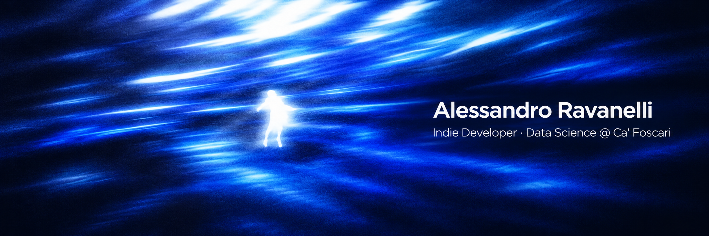

  

<h1>Hi 👋, I'm Alex</h1>

I'm a 17 years old first year student at Ca'Foscari, focused on advanced algorithms and quantative finance. 
As an aspiring quant researcher I'm building my foundation in probability, statistic and low level programming, in particular using C.
<ul>
  <li><b>Backtester in C</b>: event-driven backtesting engine on historical stock data (CSV).</li>
  <li>Currently studying: stochastic processes, time series, market microstructure.</li>
</ul>

<h2>Stack</h2>

  

  

Mobile apps with <b>Capacitor</b>.

<h2>📫 Contact</h2>

  <a href="mailto:alessandroravanelli8@gmail.com">alessandroravanelli8@gmail.com</a>

